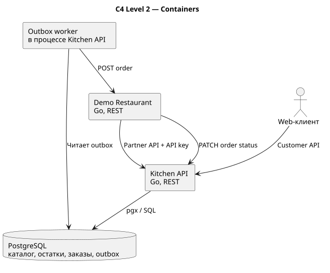

<h1 align="center">Restaurant Delivery Platform</h1>

<p align="center">
  Backend-платформа для автоматизации заказов и доставки еды из ресторанов<br>
  <strong>Go · React · TypeScript · PostgreSQL · SSE · Transactional Outbox · Docker</strong>
</p>

<p align="center">
  
  
  
  
  
</p>

## О проекте

Система автоматизирует путь ресторанного заказа: публикацию меню, проверку цен и остатков, оформление заказа, передачу заведению и отслеживание статуса до доставки.

Текущая версия реализует основной API как модульный Go-сервис и отдельный сервис демонстрационного ресторана. Границы модулей, контракт интеграции и transactional outbox позволяют последовательно выделять компоненты в самостоятельные микросервисы без изменения пользовательского API.

## Что реализовано

- каталог ресторанов и актуальное меню;
- три полноценных restaurant fixture с раздельными меню и партнёрскими ключами;
- рабочий поиск и фильтрация каталога по доступности и рейтингу;
- расчёт заказа по серверным ценам и остаткам;
- идемпотентное создание заказа;
- жизненный цикл `pending → accepted → preparing → ready → delivering → delivered`;
- партнёрский API для чтения и атомарного обновления меню, остатков, стоп-листа и статусов;
- надёжная передача заказов через transactional outbox;
- повтор доставки при временной недоступности ресторана;
- параллельная доставка outbox с exponential backoff, dead-letter и идемпотентными event headers;
- версионированный контракт событий с `occurred_at` и автоматическая retention-очистка event-журналов;
- аудит переходов статуса;
- адаптивный web-клиент: каталог, меню, корзина, оформление и отслеживание;
- каталог без фиктивных fallback-данных: карточки и меню формируются из PostgreSQL/API;
- серверная проверка корзины и единый расчёт блюд вместе с доставкой;
- история заказов пользователя;
- обновление статуса заказа через Server-Sent Events;
- восстановление SSE после разрыва через стабильный `Last-Event-ID`, PostgreSQL replay и heartbeat;
- backend-контур регистрации и входа: bcrypt, JWT access token и ротация refresh token;
- профиль и сохранённые адреса с автоматическим выбором основного при оформлении;
- кабинет ресторана: вход по API key, realtime-очередь заказов с автоматическим переподключением, управление статусами и адаптивный редактор меню;
- отдельные URL экранов и восстановление корзины после перезагрузки;
- состояния загрузки, ошибок и повтор запросов;
- Prometheus endpoint с RED, Go runtime, PostgreSQL pool и outbox-метриками;
- готовый локальный профиль Prometheus, Grafana, Loki, Tempo, OpenTelemetry Collector и ClickHouse с техническим и бизнес-dashboard;
- OpenAPI-контракты, C4, ER, sequence-диаграмма и CJM;
- unit- и E2E-тесты, включая конкурентное списание последнего товара.

## Архитектура



Основной сервис разделён на HTTP-транспорт, бизнес-логику заказов, хранилище и интеграционный worker. Создание заказа, фиксация позиций, изменение остатков и запись outbox-события выполняются в одной транзакции PostgreSQL.

```text
Web-клиент ──REST / SSE──> Platform API ──> PostgreSQL
                              │                 │
                              └─ Outbox worker ─┘
                                       │
                                       ▼
                               Restaurant API
```

Дополнительные схемы:

- [контекст системы](docs/rendered/c4-context.svg);
- [последовательность создания заказа](docs/rendered/order-sequence.svg);
- [модель данных](docs/rendered/database.svg);
- [CJM пользователя](docs/rendered/customer.svg);
- [CJM ресторана](docs/rendered/restaurant.svg).

## Быстрый запуск

Понадобятся Docker и Docker Compose.

```bash
git clone https://github.com/leedcee/restaurant-delivery-microservices.git
cd restaurant-delivery-microservices
docker compose up --build -d
```

После запуска доступны:

| Компонент | Адрес |
|---|---|
| Web-клиент | `http://localhost:5173` |
| Platform API | `http://localhost:8080` |
| Demo Restaurant | `http://localhost:8081` |
| PostgreSQL | `localhost:5432` |

Проверка готовности и получение каталога:

```bash
curl http://localhost:8080/health/ready
curl http://localhost:8080/api/v1/restaurants
```

После запуска загружаются три ресторанных fixture. Все они принимают заказы через демонстрационный интеграционный сервис и автоматически проводят заказ до статуса `delivered`.

Для запуска базового контура наблюдаемости вместе с приложением:

```bash
make observability-up
```

После запуска дополнительно доступны Prometheus на `http://localhost:9090`, Grafana на `http://localhost:3000`, ClickHouse HTTP API на `http://localhost:8123` и метрики API на `http://localhost:8080/metrics`. Grafana автоматически получает Prometheus, Loki, Tempo и ClickHouse datasources, dashboards `Restaurant Delivery / Service Overview` и `Restaurant Delivery / Business Pilot`. Локальные учётные данные Grafana по умолчанию — `admin` / `admin`; их можно переопределить через `GRAFANA_ADMIN_USER` и `GRAFANA_ADMIN_PASSWORD`.

Prometheus хранит локальные метрики семь дней и загружает стартовые алерты для недоступности API, высокой доли 5xx, остановки outbox и появления dead-letter событий. Инструкции по реакции находятся в [runbook наблюдаемости](docs/runbooks/observability.md).

Порты Prometheus и Grafana в локальном Compose привязаны только к loopback-интерфейсу. При внешнем развёртывании `/metrics` также должен оставаться во внутренней сети и не публиковаться через пользовательский reverse proxy.

API и demo restaurant экспортируют OTLP traces через Collector в Tempo. W3C trace context передаётся между сервисами автоматически, а JSON-логи содержат `service`, `environment`, `version` и, при наличии активного span, `trace_id`/`span_id`. В Grafana Explore trace можно открыть из поля `trace_id` в Loki и перейти из Tempo к логам того же запроса. Логи и метрики хранятся семь дней, traces — сутки.

События `order_created` и `order_status_changed` записываются в отдельный PostgreSQL analytics outbox в той же транзакции, затем асинхронно доставляются в ClickHouse. В аналитический контур не попадают пользователь, адрес, email, название блюда или текст причины; заказ представлен необратимым SHA-256 ключом. Недоступность ClickHouse не блокирует оформление заказа, backlog и ingestion lag видны в Prometheus.

Обработанные записи технического и аналитического outbox по умолчанию хранятся 7 дней, dead-letter — 30 дней. Фоновая очистка удаляет их ограниченными пакетами и не затрагивает ожидающие доставки события. Параметры `EVENT_CLEANUP_INTERVAL`, `PROCESSED_EVENT_RETENTION`, `DEAD_LETTER_RETENTION` и `EVENT_CLEANUP_BATCH_SIZE` настраиваются через окружение; результат виден в метриках `event_cleanup_*`. HTTP-контракт `order.created` описан в [документации событий](docs/integration-events.md).

Для просмотра отдельных партнёрских кабинетов используйте ключи:

| Ресторан | API-ключ |
|---|---|
| Тёплый хлеб | `demo-secret` |
| Паста Лаб | `pasta-secret` |
| Рис и рыба | `sushi-secret` |

Для локальной разработки используются `JWT_SECRET=dev-only-change-me` и cookie без флага `Secure`. Перед любым внешним развёртыванием задайте собственный длинный случайный JWT-секрет через `.env` или secrets manager, установите `SESSION_COOKIE_SECURE=true` и перечислите публичные адреса web-клиента в `CORS_ALLOWED_ORIGINS`; внешний контур должен работать только через HTTPS. API также выставляет security headers и ограничивает частоту auth, quote и create-запросов по адресу непосредственного клиента.

Для отдельной frontend-разработки:

```bash
cd frontend
npm install
npm run dev
```

Vite проксирует `/api` на `http://localhost:8080`. При недоступном backend интерфейс показывает ошибку и не подменяет каталог фиктивными данными. Корзина сохраняется в `localStorage`.

Основные маршруты web-клиента:

| Экран | URL |
|---|---|
| Каталог | `/` |
| Меню ресторана | `/restaurants/{id}` |
| Оформление | `/checkout` |
| История заказов | `/orders` |
| Отслеживание | `/orders/{id}` |
| Вход и регистрация | `/login` |
| Профиль и адреса | `/profile` |
| Вход ресторана | `/partner` |
| Очередь ресторана | `/partner/orders` |
| Меню, остатки и стоп-лист | `/partner/menu` |

## Основной сценарий

1. Клиент запрашивает список ресторанов и меню.
2. `POST /api/v1/orders/quote` проверяет цены и доступные остатки.
3. `POST /api/v1/orders` создаёт заказ с Bearer access token и `Idempotency-Key`.
4. Заказ, снимки позиций, история, остатки и outbox-событие сохраняются атомарно.
5. Worker передаёт заказ отдельному сервису ресторана.
6. Ресторан подтверждает заказ и последовательно обновляет его статус.
7. Клиент получает начальное состояние через `GET /api/v1/orders/{id}`.
8. Последующие статусы поступают через `GET /api/v1/orders/{id}/events` в формате SSE.

Каждое SSE-сообщение содержит числовой `id`. Web-клиент сохраняет последний обработанный ID на время экрана и передаёт его в `Last-Event-ID` при автоматическом переподключении. Клиентский поток воспроизводит пропущенные переходы из `order_status_history`, а партнёрский поток возвращает актуальный снимок очереди с PostgreSQL high-watermark. Оба потока отправляют heartbeat каждые 15 секунд.

Сумма заказа рассчитывается только на сервере и включает стоимость доставки. Клиент перед оформлением вызывает `POST /api/v1/orders/quote`, поэтому изменение цены или остатка не приводит к созданию заказа с устаревшими данными.

## Надёжность

- уникальное ограничение и advisory lock для `Idempotency-Key`;
- `SELECT ... FOR UPDATE` для защиты остатков от overselling;
- серверный расчёт итоговой стоимости;
- атомарная запись заказа и outbox-события;
- `FOR UPDATE SKIP LOCKED` и retry интеграционного worker;
- конечный автомат допустимых переходов статуса;
- хранение API-ключа партнёра в виде SHA-256-хеша.

## API и документация

- [OpenAPI основного сервиса](api/openapi.yaml);
- [OpenAPI демонстрационного ресторана](api/demo-restaurant-openapi.yaml);
- [миграции PostgreSQL](migrations/);
- [исходники архитектурных диаграмм](docs/architecture/);
- [исходники CJM](docs/cjm/).
- [жизненный цикл заказа](docs/order-lifecycle.md);
- [контракт аналитических событий](docs/analytics-events.md);
- [контракт интеграционных событий](docs/integration-events.md);
- [ADR о PostgreSQL outbox](docs/adr/0001-postgresql-outbox.md);
- [план развития проекта](docs/roadmap.md).

API версии `0.10.0` включает регистрацию, вход, ротацию refresh token в `HttpOnly SameSite` cookie, серверный logout и отзыв token family при обнаружении повторного использования, профиль, CRUD сохранённых адресов, серверные метаданные каталога, двустороннее управление меню ресторана и realtime-очередь партнёра через SSE. Изменения состояния заказа защищены его версией, клиент может отменить заказ до начала приготовления, а отклонение и отмена возвращают зарезервированные остатки. Web-клиент хранит только короткоживущий Bearer access token, защищает личные экраны и автоматически подставляет основной адрес при оформлении. Все пользовательские endpoints требуют действительный access token.

## Разработка и тесты

```bash
go test ./...
make test-e2e
golangci-lint run ./...
cd frontend
npm run build
npm run test:e2e
cd ..
docker compose logs -f
docker compose down
```

`make test-e2e` поднимает отдельный стек из `docker-compose.e2e.yml` на портах `18080`, `18081` и `55432`, создаёт временную БД `restaurant_delivery_test`, прогоняет тесты, проверяет откат и повторное применение последней миграции на заполненной БД, а затем удаляет тестовые контейнеры. Рабочая локальная база на `5432` не используется.

Backend E2E проверяет полный путь заказа, регистрацию, повторный вход, изоляцию пользовательской истории и партнёров, чтение и атомарную замену партнёрского меню, партнёрский SSE-поток новых заказов, валидацию стоп-листа, CRUD адресов, restaurant fixtures, серверный расчёт доставки, запрет смешивания товаров разных ресторанов, идемпотентность, отмену с возвратом остатков, optimistic locking, валидацию ошибочных запросов, retry/dead-letter/replay outbox и защиту от конкурентного списания последней позиции. Отдельный resilience-сценарий CI останавливает ресторан, перезапускает API с pending-событием, восстанавливает доставку, а затем временно отключает PostgreSQL и проверяет readiness и повторное подключение без рестарта API.

Playwright проходит пользовательские сценарии в desktop- и mobile-viewport: поиск и фильтрацию ресторанов, регистрацию и профиль, сохранение адреса, защиту приватных маршрутов, честное поведение при недоступном каталоге, восстановление корзины, оформление заказа, получение статуса через SSE, а также вход ресторана, получение нового заказа через realtime, принятие заказа и редактирование цен, остатков и стоп-листа. Эти же проверки запускаются в GitHub Actions.

## Границы текущей версии

В прототип пока не входят реальные платежи, геокодирование и отдельное приложение курьера. Пользовательская аутентификация работает через JWT/refresh token. Координаты на карте пока схематические, а сервис ресторана используется как интеграционный контур.
